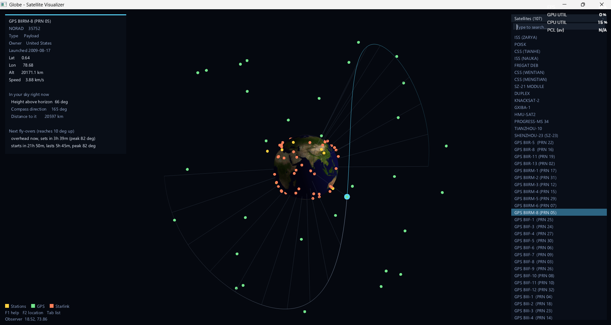

# Globe — Satellite Visualizer

A native (C++ / OpenGL) real-time satellite visualizer for Windows. It fetches
orbital data from CelesTrak, propagates it locally with SGP4, and renders
satellites over a textured 3D Earth — with live info panels, orbit + ground
tracks, a searchable catalog, and overhead/pass predictions for your location.

No account, no server, no telemetry. The only network traffic is fetching
public orbital data from CelesTrak (cached locally for hours).


<!-- Add docs/screenshot.png before publishing the release. -->

## Download & run (Windows)

1. Download the latest `globe-<version>-win64.zip` from the
   [Releases](../../releases) page.
2. Unzip it anywhere (keep `globe.exe` and the `assets/` folder together).
3. Double-click `globe.exe`.

**SmartScreen note:** the build is not code-signed, so Windows may show
"Windows protected your PC". Click **More info → Run anyway**. This is expected
for an unsigned open-source app; signing is deliberately skipped for v1.

The zip is self-contained — it bundles the required Visual C++ runtime DLLs, so
no separate redistributable install is needed. On first launch the app fetches
current orbital data (needs internet once); afterwards it uses a local cache and
a bundled offline snapshot.

## Controls

| Input | Action |
|-------|--------|
| Left-drag / arrow keys | Rotate the globe |
| Scroll | Zoom (eased) |
| Left-click a satellite | Select it (info panel + orbit/ground track) |
| Click empty space | Clear selection |
| Type (with list open) | Filter the catalog by name / NORAD id |
| Mouse wheel over list | Scroll the list |
| `Tab` | Show/hide the satellite list |
| `F1` | About / controls / attributions |
| `F2` | Set your location (city search or `lat,lon`) |
| `Esc` | Clear the filter, or quit |

Your location and window size persist between runs
(`%LOCALAPPDATA%\globe\settings.cfg`).

## Data & attribution

- **Orbital data (TLEs) and catalog (SATCAT): [CelesTrak](https://celestrak.org)**
  — courtesy of Dr. T.S. Kelso. Fetched at runtime and cached; please don't poll
  aggressively.
- **City gazetteer: [GeoNames](https://www.geonames.org)** — bundled
  `cities15000.txt`, licensed [CC BY 4.0](https://creativecommons.org/licenses/by/4.0/).
- **Earth texture:** NASA "Blue Marble" imagery (public domain).

Full license texts for all bundled open-source libraries (GLFW, GLM, GLAD, stb,
libsgp4, cpr, libcurl) are in [`THIRD-PARTY-LICENSES.txt`](THIRD-PARTY-LICENSES.txt),
which is included in every release zip.

## Building from source

**Requirements**
- CMake 3.24+
- A C++20 compiler (MSVC 2022 recommended)
- Python 3 (GLAD generates its loader at build time)
- Internet access on the **first** configure (FetchContent downloads the
  dependencies; they are cached in the build directory afterward)

```sh
cmake -S . -B build -G "Visual Studio 17 2022"
cmake --build build --config Release
./build/Release/globe.exe
```

Dependencies are fetched automatically — there is no separate install step. See
[`PLAN.md`](PLAN.md) for the full architecture and roadmap.

### Packaging a release zip

```powershell
pwsh scripts/package.ps1
```

This builds Release in the existing `build/` tree (no re-download), stages the
exe, `assets/`, the VC++ runtime DLLs, `THIRD-PARTY-LICENSES.txt`, and this
README into `dist/globe-<version>-win64/`, and zips it.

## License

globe is released under the [MIT License](LICENSE) — © 2026 Aditi S.
(Aditi-exe). Bundled third-party libraries retain their own licenses
(see `THIRD-PARTY-LICENSES.txt`).
